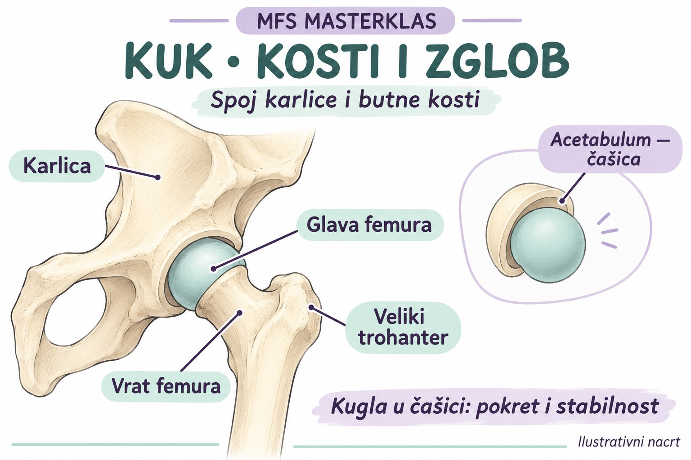
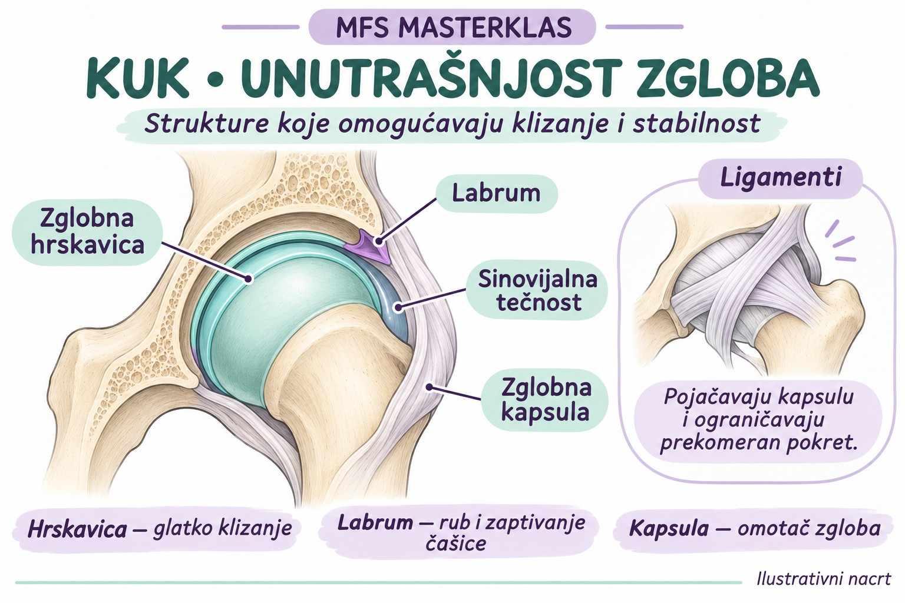
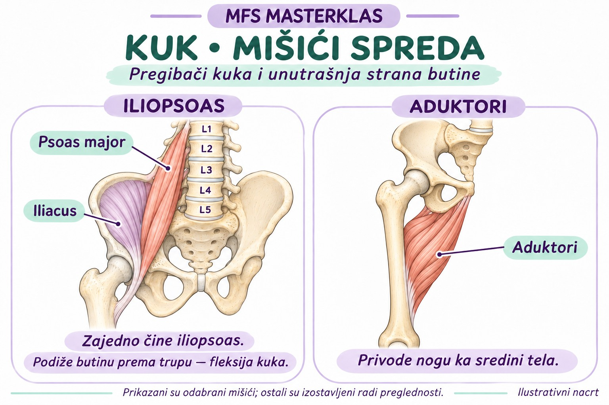
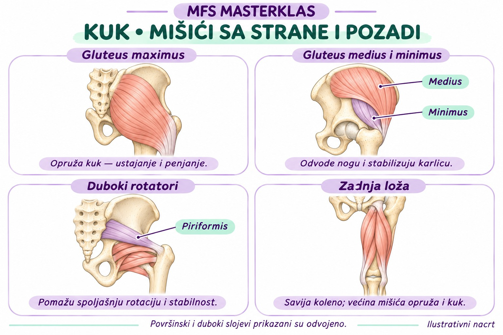

# Kuk — anatomija koju treba da razumemo

Prva lekcija MFS Masterklasa. Cilj: prepoznati glavne strukture kuka i razumeti čemu služe, bez učenja svakog anatomskog detalja napamet.

## 1. Šta je kuk?

Kuk je spoj karlice i butne kosti — femura. Pripada kuglastim zglobovima: glava femura predstavlja „kuglu“, a acetabulum na karlici „čašicu“.

Istovremeno omogućava kretanje noge i prenosi opterećenje između trupa i donjeg ekstremiteta. Stabilnost zajedno obezbeđuju oblik kostiju, labrum, kapsula, ligamenti i mišići. [1, 2]

## 2. Kosti i koštani orijentiri

| Struktura | Šta je i zašto je važna |
|---|---|
| Acetabulum | Udubljenje na karlici u koje naleže glava femura. |
| Glava femura | Zaobljeni gornji deo butne kosti koji se kreće u acetabulumu. |
| Vrat femura | Deo između glave i tela femura; učestvuje u prenosu opterećenja. |
| Veliki trohanter | Koštano ispupčenje sa spoljašnje strane gornjeg femura; mesto pripoja više mišića. Nije sama zglobna površina. |
| Mali trohanter | Manje ispupčenje na unutrašnjoj i zadnjoj strani gornjeg femura; pripoj iliopsoasa. |

**Za pamćenje:** koštano ispupčenje koje napipamo sa strane kuka nije glava femura. Sam zglob je dublje. [1, 3]

## 3. Šta se nalazi u zglobu i oko njega?

| Struktura | Glavna uloga |
|---|---|
| Zglobna hrskavica | Prekriva zglobne površine; omogućava glatko klizanje i raspodelu opterećenja. |
| Labrum | Prsten vlaknaste hrskavice na obodu acetabuluma; produbljuje čašicu i pomaže njenom zaptivanju. |
| Zglobna kapsula | Čvrst omotač oko zgloba koji doprinosi stabilnosti. |
| Ligamenti | Pojačavaju kapsulu i ograničavaju prekomerne pokrete. |
| Sinovijalna membrana | Oblaže unutrašnju stranu kapsule i stvara sinovijalnu tečnost. |
| Sinovijalna tečnost | Podmazuje zglob i pomaže ishrani zglobne hrskavice. |

**Hrskavica i labrum nisu isto:** hrskavica oblaže površine koje klize, a labrum okružuje rub čašice. [1, 2]

## 4. Glavni mišići kuka

| Mišić ili grupa | Gde se nalazi | Glavna uloga |
|---|---|---|
| Iliopsoas | Duboko spreda | Pregiba kuk — podiže butinu prema trupu. Čine ga psoas major i iliacus. |
| Aduktori | Unutrašnja strana butine | Privode nogu ka sredini tela; učestvuju i u drugim pokretima, zavisno od položaja kuka. |
| Gluteus maximus | Pozadi, površinski | Opruža kuk, naročito pri ustajanju i penjanju; pomaže spoljašnju rotaciju. |
| Gluteus medius i minimus | Sa strane, u različitim slojevima | Odvode nogu i kontrolišu položaj karlice pri osloncu na jednu nogu. |
| Zadnja loža | Zadnja strana butine | Savija koleno; većina mišića grupe opruža i kuk. Kratka glava bicepsa femorisa ne prelazi kuk. |
| Duboki rotatori | Duboko pozadi | Pomažu spoljašnju rotaciju i stabilizaciju kuka; među njima je piriformis. |

Mišići rade zajedno. Njihova uloga zavisi i od položaja zgloba i od toga da li pomeramo nogu ili kontrolišemo karlicu nad oslonjenom nogom. Tabela prikazuje glavne uloge, ne sve moguće funkcije. [3, 4]

## 5. Tetive i burze

**Tetive** povezuju mišiće sa kostima i prenose njihovu silu.

**Burze** su male vrećice sa tečnošću koje smanjuju trenje između okolnih tkiva. Oko kuka ih ima više, uključujući burze u predelu velikog trohantera i iliopsoasa.

Tetiva, burza i sam zglob predstavljaju različite strukture, iako se nalaze blizu jedna drugoj. [5]

## 6. Šta treba da ostane u glavi?

- Kosti daju oblik i oslonac.
- Hrskavica omogućava glatko kretanje zglobnih površina.
- Labrum pomaže zaptivanju i stabilnosti čašice.
- Kapsula i ligamenti ograničavaju prekomeran pokret.
- Mišići pokreću kuk i kontrolišu karlicu.
- Tetive prenose silu, a burze smanjuju trenje.

**Nastavak:** [Lekcija 02 — funkcija i biomehanika kuka](../biomehanika/README.md), uz hodanje, čučanj, ustajanje, hip hinge i oslonac na jednu nogu.

**Dodatno:** [Mapa pojedinačnih mišića kuka](mapa-misica.md) i [stručna vizuelna provera naših ilustracija](provera-ilustracija.md). Ove dve datoteke razdvajaju proverene anatomske činjenice od didaktičkih aproksimacija na crtežima.

## Izvori i status

Obnovljena lekcija, 4. novembar 2026, na osnovu pronađenog sažetka prethodnog razgovora i stručnih izvora. Nije doslovan prepis ranije poruke. Ilustracije su odobreni ilustrativni nacrti; ne prikazuju sve strukture ni sve njihove pripoje.

1. [AAOS — Hip Arthroscopy, Anatomy](https://www.orthoinfo.org/treatment/hip-arthroscopy/)
2. [University of Virginia — Patient’s Guide to the Hip](https://med.virginia.edu/orthopaedic-surgery/wp-content/uploads/sites/242/2020/11/Gwathmey-Patient-guide-hip.pdf)
3. [OpenStax — Appendicular Muscles of the Pelvic Girdle and Lower Limbs](https://openstax.org/books/anatomy-and-physiology-2e/pages/11-6-appendicular-muscles-of-the-pelvic-girdle-and-lower-limbs)
4. [AAOS — Hip Conditioning Program](https://www.orthoinfo.org/recovery/hip-conditioning-program)
5. [AAOS — Snapping Hip](https://www.orthoinfo.org/diseases--conditions/snapping-hip/)
