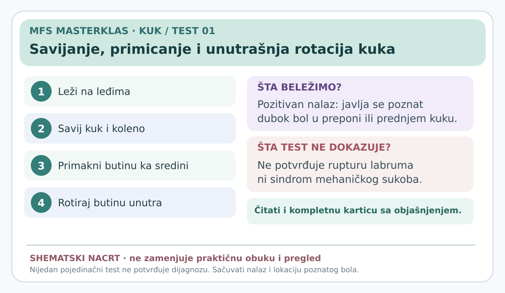

# Savijanje, primicanje i unutrašnja rotacija kuka

> **Vizuelni sažetak:** 

**Status:** edukativna radna kartica za stručnu proveru (7. novembar 2026). Nije samostalna dijagnoza.

**Glavni razlog za testiranje:** Provokacija poznatog dubokog bola u preponi.

## Šta znači ovaj test?

Proveravamo da li kombinacija **savijanja, primicanja i unutrašnje rotacije butne kosti** reprodukuje pacijentov poznati duboki bol u preponi. Ovaj položaj može provocirati simptome koji potiču iz samog zgloba kuka, ali nije specifičan za jednu povredu.

## Izvođenje — detaljno

1. Osoba leži na leđima, sa opuštenom nogom na stolu. Pre početka saznajemo gde je njen uobičajeni bol i da li postoje upozoravajući simptomi.
2. Ispitivač podržava butinu i potkolenicu, savija **kuk i koleno približno do pravog ugla**. Karlica ne sme da se slobodno okreće.
3. Savijeno koleno polako pomera prema srednjoj liniji tela — to je **primicanje butine**.
4. Zatim pažljivo rotira butnu kost **prema unutra**. Kada je koleno savijeno, potkolenica i stopalo idu **prema spolja**, što često zbunjuje početnike.
5. Ispitivač se zaustavlja kada osoba prijavi prepoznatljiv bol ili kada bezbedan raspoloživi opseg prestaje. **Ne primenjuje nagli pritisak.**
6. Beleži se gde je bol, da li je to isti bol zbog kog osoba dolazi i da li je postojala kompenzacija karlicom.

## Značenje nalaza

**Pozitivan:** reprodukovan poznati duboki/preponski bol. To **podržava sumnju** na simptomatski problem unutar kuka i opravdava dalji pregled.

**Negativan:** poznati bol se ne izaziva pravilno izvedenim, tolerisanim pokretom. Time se sumnja na određene zglobne izvore može smanjiti, ali se ne mogu isključiti sva stanja.

**Neodređen:** pokret nije moguće izvesti pravilno zbog jakog bola, ukočenosti, zaštitne reakcije ili nemogućnosti stabilizacije karlice.

**Ne dokazuje:** rupturu labruma, tačan oblik koštane promene ili sindrom mehaničkog sukoba femura i acetabuluma. Kliničke smernice iz 2023. naglašavaju da negativan nalaz može biti korisniji nego pozitivan za odbacivanje nekih zglobnih uzroka.

## Kada ne testirati

Ne izvoditi ako postoje znaci koji ukazuju na mogući prelom, ozbiljnu infekciju, akutni neurološki deficit ili neuobičajeno jak bol bez medicinske procene. Ne provocirati bol silom.

## Izvori

- [Kliničke smernice za neartrotični bol u kuku (2023)](https://doi.org/10.2519/jospt.2023.0302)
- [Fizički pregled kuka (2021)](https://pmc.ncbi.nlm.nih.gov/articles/PMC8167346/)
- [Sistematski pregled testova za spoljašnji bol kuka (2024)](https://pubmed.ncbi.nlm.nih.gov/37561820/)
- [Evropski stručni konsenzus za bol kuka i prepona (2026)](https://pmc.ncbi.nlm.nih.gov/articles/PMC13622907/)

[← Povratak na pregled kartica](README.md) · [Kompletan vodič uzroka bola](../dijagnosticki-vodic/README.md)
