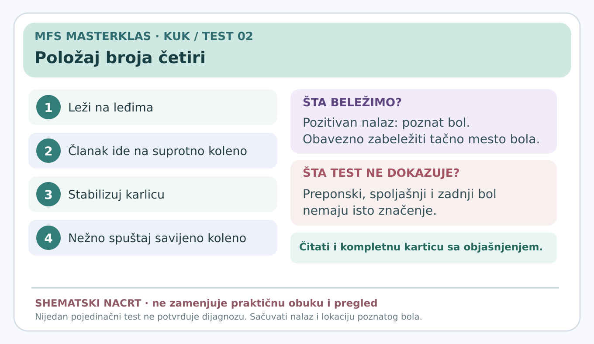

# Položaj broja četiri

> **Vizuelni sažetak:** 

**Status:** edukativna radna kartica za stručnu proveru (7. novembar 2026). Nije samostalna dijagnoza.

**Glavni razlog za testiranje:** Savijanje, odvođenje i spoljašnja rotacija.

## Šta znači ovaj test?

Kuk se dovodi u kombinaciju **savijanja, odvođenja noge u stranu i spoljašnje rotacije butne kosti**. Položaj često podseća na broj četiri kada se posmatra odozgo. Može provocirati bol iz različitih regiona, pa je **lokacija bola ključna**.

## Izvođenje — detaljno

1. Osoba leži na leđima, opuštena, sa jednom nogom ispruženom.
2. Ispitivač savija testirano koleno i postavlja **članak testirane noge iznad kolena suprotne noge**, tako da noge prave oblik nalik broju četiri.
3. Jednom rukom stabilizuje karlicu — sprečava nepotrebno okretanje tela.
4. Drugom rukom nežno dozvoljava savijenom kolenu da se spusti prema podlozi; eventualni dodatni blagi pritisak samo uz saglasnost i bez forsiranja.
5. Pita **gde se tačno javlja poznati bol**: u preponi, spoljašnjem kuku ili pozadi kod karlice.
6. Beleži opseg položaja, lokaciju simptoma i razliku u odnosu na drugu stranu.

## Značenje nalaza

**Pozitivan:** izaziva se pacijentov poznati bol ili jasno ograničenje položaja.

**Negativan:** nema poznatog bola pri pravilnom, tolerisanom izvođenju.

**Neodređen:** osoba ne može da zauzme položaj ili ispitivač ne može kontrolisati karlicu.

- **Prednji/preponski bol** može usmeriti pregled na zglobne i prednje mekotkivne izvore.
- **Spoljašnji bol** može usmeriti na glutealne tetive i trohanteričnu regiju.
- **Zadnji bol** zahteva razmatranje lumbosakralnih i drugih zadnjih izvora; sam test ne potvrđuje problem sakroilijačnog zgloba.

**Ne dokazuje:** jednu određenu bolest, rupturu labruma ili tačno poreklo zadnjeg bola.

## Kada ne testirati

Ne izvoditi ako postoje znaci koji ukazuju na mogući prelom, ozbiljnu infekciju, akutni neurološki deficit ili neuobičajeno jak bol bez medicinske procene. Ne provocirati bol silom.

## Izvori

- [Kliničke smernice za neartrotični bol u kuku (2023)](https://doi.org/10.2519/jospt.2023.0302)
- [Fizički pregled kuka (2021)](https://pmc.ncbi.nlm.nih.gov/articles/PMC8167346/)
- [Sistematski pregled testova za spoljašnji bol kuka (2024)](https://pubmed.ncbi.nlm.nih.gov/37561820/)
- [Evropski stručni konsenzus za bol kuka i prepona (2026)](https://pmc.ncbi.nlm.nih.gov/articles/PMC13622907/)

[← Povratak na pregled kartica](README.md) · [Kompletan vodič uzroka bola](../dijagnosticki-vodic/README.md)
