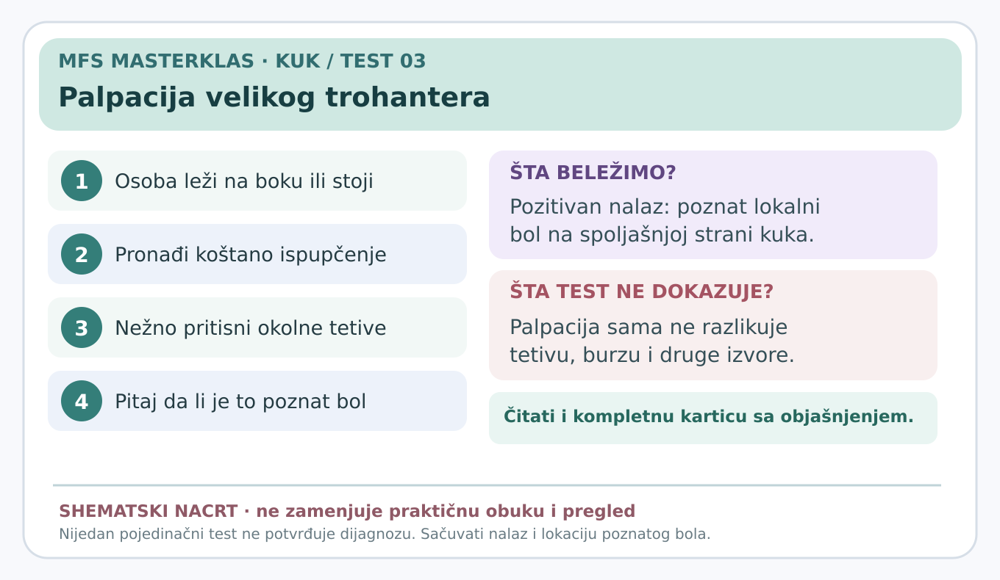

# Palpacija velikog trohantera

> **Vizuelni sažetak:** 

**Status:** edukativna radna kartica za stručnu proveru (7. novembar 2026). Nije samostalna dijagnoza.

**Glavni razlog za testiranje:** Provokacija prepoznatljivog spoljašnjeg bola.

## Šta znači ovaj test?

Veliki trohanter je koštano ispupčenje sa **spoljašnje strane gornjeg dela butne kosti**. Oko njega se nalaze pripoji glutealnih mišića i burze, male vrećice koje smanjuju trenje. Cilj nije samo pronaći osetljivo mesto, već videti da li pritisak izaziva **baš poznati lateralni bol**.

## Izvođenje — detaljno

1. Osoba stoji ili leži na boku tako da je bolna strana dostupna, uz udoban i stabilan položaj.
2. Ispitivač identifikuje veliko koštano ispupčenje na spoljašnjoj strani gornjeg dela butine.
3. Uz pristanak postepeno i nežno palpira okolinu pripoja glutealnih tetiva, naročito posterolateralni deo trohantera.
4. Osoba kaže da li je pritisak izazvao njen **uobičajeni** bol, a ne samo nelagodnost od jačeg pritiskanja.
5. Ispitivač, koliko je primereno, upoređuje nalaz sa suprotnim kukom; ne pojačava pritisak da bi „izvukao pozitivan test”.

## Značenje nalaza

**Pozitivan:** reprodukovan je poznati spoljašnji bol nad trohanteričnom regijom.

**Negativan:** ciljani prepoznatljiv bol se ne javlja pri primerenom pritisku.

**Neodređen:** nije moguće precizno odrediti koštani orijentir ili pritisak nije tolerisan.

**Šta ne dokazuje:** izolovan burzitis ili rupturu glutealne tetive. U sistematskom pregledu iz 2024. ova palpacija je korisna **u kombinaciji sa testom odvođenja kuka protiv otpora**, posebno kod osoba koje već imaju lateralni bol.

## Kada ne testirati

Ne izvoditi ako postoje znaci koji ukazuju na mogući prelom, ozbiljnu infekciju, akutni neurološki deficit ili neuobičajeno jak bol bez medicinske procene. Ne provocirati bol silom.

## Izvori

- [Kliničke smernice za neartrotični bol u kuku (2023)](https://doi.org/10.2519/jospt.2023.0302)
- [Fizički pregled kuka (2021)](https://pmc.ncbi.nlm.nih.gov/articles/PMC8167346/)
- [Sistematski pregled testova za spoljašnji bol kuka (2024)](https://pubmed.ncbi.nlm.nih.gov/37561820/)
- [Evropski stručni konsenzus za bol kuka i prepona (2026)](https://pmc.ncbi.nlm.nih.gov/articles/PMC13622907/)

[← Povratak na pregled kartica](README.md) · [Kompletan vodič uzroka bola](../dijagnosticki-vodic/README.md)
