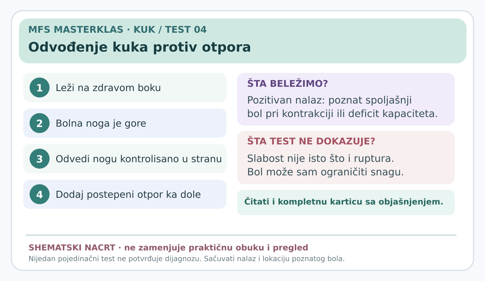

# Odvođenje kuka protiv otpora

> **Vizuelni sažetak:** 

**Status:** edukativna radna kartica za stručnu proveru (7. novembar 2026). Nije samostalna dijagnoza.

**Glavni razlog za testiranje:** Provokacija lateralnog bola pri radu abduktora.

## Šta znači ovaj test?

Procena se odnosi na **mišiće koji odvode butinu u stranu**, prvenstveno gluteus medius i gluteus minimus, i na reakciju njihovih tetiva pod opterećenjem. Kod osoba sa spoljašnjim bolom kuka može pomoći u proceni sindroma bola velikog trohantera.

## Izvođenje — detaljno

1. Osoba leži na **strani koja je manje bolna**, pa je testirana noga gore.
2. Donja noga po potrebi je savijena radi stabilnosti; testirana noga je opružena ili postavljena u dobro kontrolisan položaj. Karlica ostaje mirna.
3. Osoba polako podiže gornju nogu **u stranu od donje noge**, bez uvrtanja trupa ili kompenzacije karlicom.
4. Ispitivač daje **postepeni otpor prema dole** na spoljašnji deo testirane noge, u skladu sa metodom i sposobnošću osobe, bez naglog guranja.
5. Beleži se pojava poznatog bola baš kod spoljašnje strane kuka, približan kapacitet zadržavanja i postojanje kompenzacija.

## Značenje nalaza

**Pozitivan za provokaciju lateralnog bola:** izaziva se poznat bol u trohanteričnoj regiji.

**Mogući dodatni nalaz:** smanjen kapacitet ili bolno ograničena snaga. To treba odvojeno opisati, a ne nazivati istom vrstom pozitivnog nalaza.

**Negativan:** nema poznatog bola pri standardizovanom i tolerisanom otporu.

**Neodređen:** nije moguće održati položaj karlice ili dozirati otpor pouzdano.

**Šta ne dokazuje:** sam test ne potvrđuje tendinopatiju ili rupturu glutealnih tetiva. **Uparivanje sa palpacijom** ima bolju dijagnostičku vrednost za sindrom bola velikog trohantera nego bilo koji test sam.

## Kada ne testirati

Ne izvoditi ako postoje znaci koji ukazuju na mogući prelom, ozbiljnu infekciju, akutni neurološki deficit ili neuobičajeno jak bol bez medicinske procene. Ne provocirati bol silom.

## Izvori

- [Kliničke smernice za neartrotični bol u kuku (2023)](https://doi.org/10.2519/jospt.2023.0302)
- [Fizički pregled kuka (2021)](https://pmc.ncbi.nlm.nih.gov/articles/PMC8167346/)
- [Sistematski pregled testova za spoljašnji bol kuka (2024)](https://pubmed.ncbi.nlm.nih.gov/37561820/)
- [Evropski stručni konsenzus za bol kuka i prepona (2026)](https://pmc.ncbi.nlm.nih.gov/articles/PMC13622907/)

[← Povratak na pregled kartica](README.md) · [Kompletan vodič uzroka bola](../dijagnosticki-vodic/README.md)
