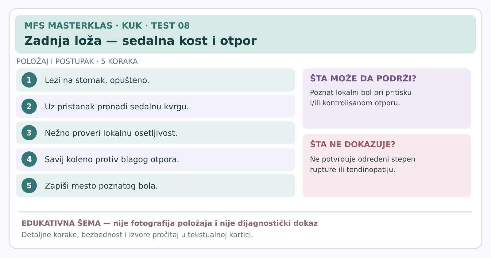

# Kartica 08 — Zadnja loža: sedalna kost i otpor savijanju kolena

**Status:** edukativna kartica za stručnu reviziju; nije samostalni dijagnostički postupak. **Datum:** 7. novembar 2026.

**Važno za sve testove:** prethodno uraditi anamnezu, isključiti upozoravajuće znake, objasniti postupak, dobiti pristanak i beležiti *poznat* simptom, a ne bilo kakvu nelagodnost. Ako postoji sumnja na prelom, akutno odvajanje tetive, ozbiljnu infekciju ili hitno neurološko stanje, ne izazivati simptome. Testove izvodi osoba obučena za odgovarajući postupak.

**Svrha:** Da li se poznati zadnji bol javlja blizu pripoja zadnje lože i pri njenom kontrolisanom opterećenju?

## Šta je sedalna kost?

**Sedalna kvrga** je koštano ispupčenje na dnu karlice na kojem sedimo. Tu se pripaja najveći deo mišića zadnje lože. **Proksimalna tendinopatija zadnje lože** znači bol i smanjenu toleranciju na opterećenje u predelu tetive blizu tog pripoja; ne treba je poistovetiti sa svakim bolom pri sedenju.

## Izvođenje

1. Pitati kako je bol nastao. **Ako je bol počeo naglo uz osećaj pucanja, veliku modricu, izraženu slabost ili teškoće pri hodu**, prekinuti rutinsko testiranje i tražiti medicinsku procenu zbog moguće rupture ili odvajanja tetive od kosti.
2. Osoba leži potrbuške, opuštena, sa odgovarajućim prekrivanjem sedalne regije. Ispitivač objašnjava mesto dodira i traži izričit pristanak.
3. Pronaći sedalnu kvrgu prema anatomskim orijentirima. Ne pritiskati direktno nervne strukture i ne koristiti jak pritisak samo da bi se izazvao bol.
4. Nežno palpirati proksimalnu regiju tetivnog pripoja; pitati da li je osećaj **isti kao bol zbog kog se osoba javila**.
5. Osoba savije koleno do udobnog ugla, na primer približno do pola između opruženog i pravog ugla. Ispitivač rukom kontrolisano pruža otpor na zadnju stranu potkolenice, dok osoba pokušava da koleno dodatno savije. Jačina i položaj treba da budu zabeleženi.
6. Uporediti strane, bolnu regiju i funkcionalni kapacitet. Bol i slabiji kapacitet opisati **odvojeno**.

## Tumačenje

- **Poznat lokalni bol na pripoju i pri doziranom opterećenju** podržava sumnju na problem proksimalne zadnje lože uz odgovarajuću anamnezu.
- **Bez takve reakcije** ne isključuje tendinopatiju, posebno kada se simptomi javljaju samo na velikim brzinama ili dužem sedenju.
- **Neodređen nalaz:** anatomija nije pouzdano palpabilna, bol je difuzan ili osoba ne može pravilno opteretiti nogu.

**Ne može da pokaže:** da li je u pitanju tendinopatija, manja ili velika ruptura, stupanj oštećenja, niti da li je uključen išijadični nerv. Dokazi za palpaciju kao samostalan dijagnostički test su ograničeni.

## Izvori

[Cacchio i saradnici, pouzdanost testova zadnje lože u 92 sportista (2012)](https://pubmed.ncbi.nlm.nih.gov/22219215/) · [Pregled povreda zadnje lože (2016)](https://pmc.ncbi.nlm.nih.gov/articles/PMC5003616/) · [Nacionalna zdravstvena služba Velike Britanije — povreda zadnje lože](https://www.nhs.uk/conditions/hamstring-injury/)

---
[← Sve kartice kuka](README.md) · [Atlas bola i diferencijalna procena](../dijagnosticki-vodic/README.md)
