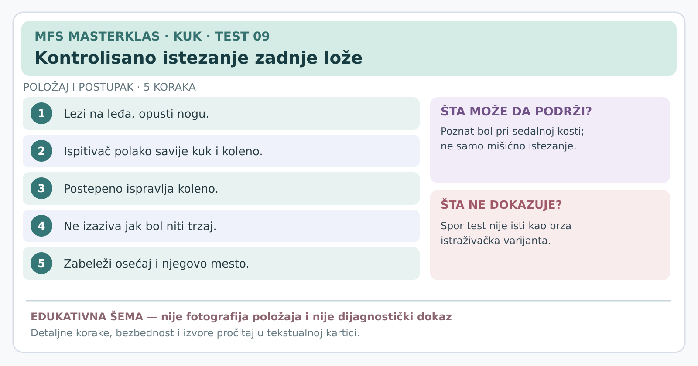

# Kartica 09 — Kontrolisano istezanje proksimalne zadnje lože

**Status:** edukativna kartica za stručnu reviziju; nije samostalni dijagnostički postupak. **Datum:** 7. novembar 2026.

**Važno za sve testove:** prethodno uraditi anamnezu, isključiti upozoravajuće znake, objasniti postupak, dobiti pristanak i beležiti *poznat* simptom, a ne bilo kakvu nelagodnost. Ako postoji sumnja na prelom, akutno odvajanje tetive, ozbiljnu infekciju ili hitno neurološko stanje, ne izazivati simptome. Testove izvodi osoba obučena za odgovarajući postupak.

**Svrha:** Da li istezanje zadnje lože reprodukuje prepoznatljiv bol kod sedalne kosti?

## Osnovni pojmovi

Mišići zadnje lože protežu se pozadi duž butine. **Kada je kuk savijen, a koleno se opruža, zadnja loža se izdužuje**. To može provocirati bol proksimalne tetive, ali i neugodan osećaj istezanja kod zdrave osobe.

## Izvođenje sporog testa sa savijenim kolenom

1. Osoba leži na leđima na čvrstoj i stabilnoj podlozi.
2. Ispitivač pridržava butinu i potkolenicu i polako savija kuk i koleno testirane noge.
3. Držeći kuk u fleksiji koju osoba toleriše, **postepeno** ispravlja koleno. Ne pokušava da ga ispravi do kraja po svaku cenu.
4. Pita gde nastaje osećaj: na sedalnoj kosti, sredinom zadnje butine, ili se širi niz nogu uz peckanje ili trnjenje.
5. Prekida čim nastane dovoljno informativan, prepoznatljiv simptom. Ne koristi nagli trzaj.

## Tumačenje

- **Poznat lokalni bol kod sedalne kosti** može podržati sumnju na proksimalnu tendinopatiju zadnje lože kada se uklapa u anamnezu i druge nalaze.
- **Samo uobičajeno zatezanje mišića**, posebno sličnog intenziteta na obe strane, **nije pozitivan bolni nalaz**.
- **Trnjenje ili širenje ka stopalu** zahteva proširenu procenu nervnih simptoma.
- **Negativan nalaz** ne isključuje tendinopatiju; može biti potrebna procena pri funkcionalnom opterećenju ili upućivanje.

**Stručna napomena:** u istraživanjima je ispitivana i brza „modifikovana” varijanta testa. Ovde **namerno navodimo sporiji postupak** za edukativnu karticu, jer brza varijanta nije prikladna za nestručnu primenu, naročito nakon akutne povrede. Rezultate studija brze varijante **ne smemo pripisati ovoj sporoj varijanti**.

## Izvori

[Cacchio i saradnici, pouzdanost testova zadnje lože u 92 sportista (2012)](https://pubmed.ncbi.nlm.nih.gov/22219215/) · [Pregled povreda zadnje lože (2016)](https://pmc.ncbi.nlm.nih.gov/articles/PMC5003616/) · [Nacionalna zdravstvena služba Velike Britanije — povreda zadnje lože](https://www.nhs.uk/conditions/hamstring-injury/)

---
[← Sve kartice kuka](README.md) · [Atlas bola i diferencijalna procena](../dijagnosticki-vodic/README.md)
