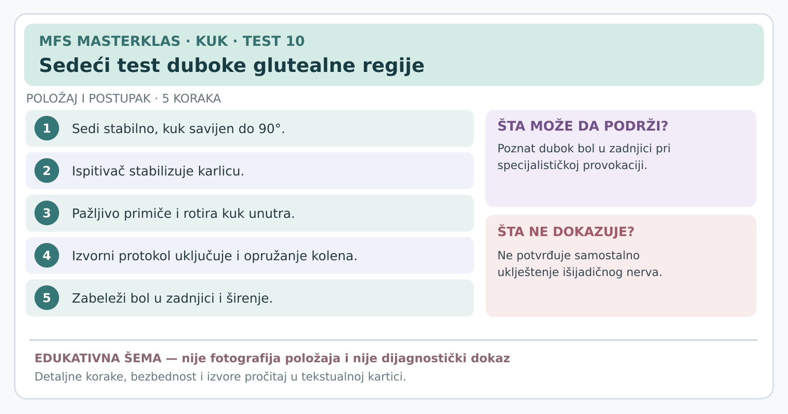

# Kartica 10 — Sedeći test istezanja duboke glutealne regije

**Status:** edukativna kartica za stručnu reviziju; nije samostalni dijagnostički postupak. **Datum:** 7. novembar 2026.

**Važno za sve testove:** prethodno uraditi anamnezu, isključiti upozoravajuće znake, objasniti postupak, dobiti pristanak i beležiti *poznat* simptom, a ne bilo kakvu nelagodnost. Ako postoji sumnja na prelom, akutno odvajanje tetive, ozbiljnu infekciju ili hitno neurološko stanje, ne izazivati simptome. Testove izvodi osoba obučena za odgovarajući postupak.

**Svrha:** Da li savijanje, primicanje i unutrašnja rotacija kuka provociraju poznat dubok glutealni bol?

## Šta je duboka glutealna regija?

To su strukture duboko ispod velikog glutealnog mišića, uključujući kratke mišiće rotatore kuka i **išijadični nerv** koji prolazi kroz to područje. **Duboki glutealni sindrom** je grupa stanja kod kojih su simptomi povezani sa mogućom iritacijom ili pritiskom na nerv **izvan kičme**. Nije isto što i „uvek je piriformis kriv”.

## Izvođenje

1. Osoba sedi stabilno na ivici stola, leđa i karlica koliko je moguće u kontrolisanom položaju, kukovi približno savijeni pod pravim uglom.
2. Ispitivač pridržava testiranu nogu i stabilizuje karlicu.
3. Prvo polako **primiče** butinu srednjoj liniji tela i **rotira butnu kost unutra**, u smeru koji isteže pojedine duboke rotatore.
4. U originalnom opisnom protokolu dodatno se **opruža koleno** radi angažovanja nervnog tkiva; ovu kombinaciju i eventualnu duboku palpaciju izvodi samo posebno obučen zdravstveni radnik.
5. Ispitivač pita: „Da li je ovo poznati duboki bol u zadnjici, širi li se i kuda?”.
6. Odmah prekida pri jakim ili neobičnim neuralnim simptomima.

## Tumačenje

- **Pozitivan:** poznati duboki glutealni bol reprodukovan je kontrolisanim postupkom, nekad sa širenjem.
- **Negativan:** poznati bol nije izazvan u ispravnom, tolerisanom postupku.
- **Neodređen:** koraci originalnog protokola nisu izvođeni, postoji previsoka iritabilnost ili osoba ne može bezbedno zauzeti položaj.

**Ograničenje dokaza:** istraživanje sa 33 osobe, među kojima je 23 imalo endoskopski potvrđeno uklještenje nerva, prijavilo je **91% osetljivosti i 80% specifičnosti** za **kombinaciju ovog i aktivnog testa dubokih rotatora**. To **nisu rezultati samog sedećeg testa**, niti se mogu preneti na sve pacijente sa zadnjim bolom. Kod bola koji se širi niz nogu obavezno razmotriti lumbalnu kičmu.

## Izvori

[Deep gluteal syndrome — stručni pregled (2015)](https://pmc.ncbi.nlm.nih.gov/articles/PMC4718497/) · [Martin i saradnici — tačnost kombinacije testova u 33 operisana pacijenta (2014)](https://pubmed.ncbi.nlm.nih.gov/24217716/) · [Pregled ograničenja dijagnostike (2019)](https://pmc.ncbi.nlm.nih.gov/articles/PMC6774708/)

---
[← Sve kartice kuka](README.md) · [Atlas bola i diferencijalna procena](../dijagnosticki-vodic/README.md)
