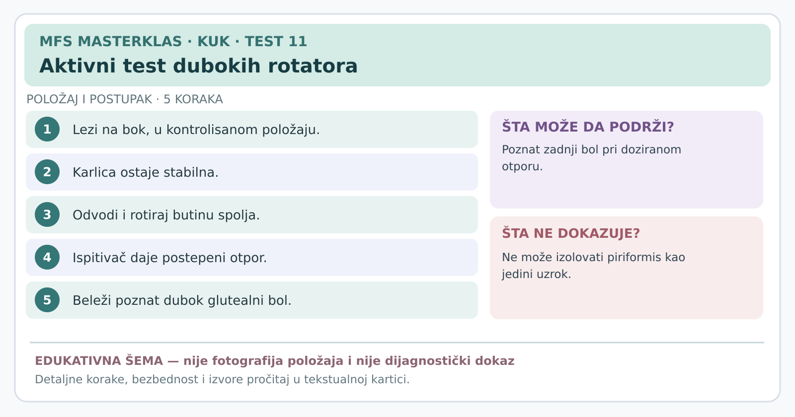

# Kartica 11 — Aktivni test dubokih rotatora kuka

**Status:** edukativna kartica za stručnu reviziju; nije samostalni dijagnostički postupak. **Datum:** 7. novembar 2026.

**Važno za sve testove:** prethodno uraditi anamnezu, isključiti upozoravajuće znake, objasniti postupak, dobiti pristanak i beležiti *poznat* simptom, a ne bilo kakvu nelagodnost. Ako postoji sumnja na prelom, akutno odvajanje tetive, ozbiljnu infekciju ili hitno neurološko stanje, ne izazivati simptome. Testove izvodi osoba obučena za odgovarajući postupak.

**Svrha:** Da li kontrakcija dubokih rotatora pri odvođenju i spoljašnjoj rotaciji izaziva poznat zadnji bol?

## Šta proveravamo?

Odvođenje butine u stranu i njena spoljašnja rotacija aktiviraju više mišića kuka. U pojedinim položajima istovremeno opterećuju duboku glutealnu regiju. Bol pri tom pokretu nije dokaz da je jedan mišić „prekratak” ili da on direktno pritiska nerv.

## Izvođenje — specijalistička verzija opisana u literaturi

1. Osoba leži **na boku**, sa testiranom nogom i kukom u položaju koji se može kontrolisati bez bola.
2. Ispitivač osigurava stabilnost karlice i objašnjava osobi da će protiv blagog otpora pokušati da **odvede** butinu i **rotira je spolja**.
3. U originalnom testu „aktivnog piriformisa” osoba tokom bočnog položaja **pritiska petu u podlogu** i aktivno odvodi/rotira kuk protiv otpora. Za pravilnu demonstraciju ove verzije neophodna je praktična stručna obuka i provera položaja.
4. Ispitivač pruža postepen, kontrolisan otpor, bez naglog guranja. Palpacija duboke glutealne regije, kada je indicirana, zahteva profesionalne kompetencije i pristanak.
5. Beleži se poznati dubok zadnji bol, širenje duž noge i da li je pokret izveden bez kompenzacije trupa.

## Tumačenje

- **Pozitivan:** isti dubok glutealni bol izazvan je aktivnim otporom.
- **Negativan:** takav bol nije izazvan pravilnom, tolerisanom izvedbom.
- **Neodređen:** nije izveden originalni položaj, bol sprečava pokret ili je kompenzacija velika.

**Šta ne dokazuje:** određeni mišić nije moguće pouzdano izolovati, a jedan pozitivan test ne potvrđuje kompresiju išijadičnog nerva.

**Dokaz:** kada se ovaj test kombinuje sa odgovarajućim sedećim testom istezanja, u maloj specijalističkoj grupi dobijena je osetljivost 91% i specifičnost 80%. **Ne pripisivati kombinovane brojke ovom jednom testu**, niti drugim varijacijama položaja.

## Izvori

[Deep gluteal syndrome — stručni pregled (2015)](https://pmc.ncbi.nlm.nih.gov/articles/PMC4718497/) · [Martin i saradnici — tačnost kombinacije testova u 33 operisana pacijenta (2014)](https://pubmed.ncbi.nlm.nih.gov/24217716/) · [Pregled ograničenja dijagnostike (2019)](https://pmc.ncbi.nlm.nih.gov/articles/PMC6774708/)

---
[← Sve kartice kuka](README.md) · [Atlas bola i diferencijalna procena](../dijagnosticki-vodic/README.md)
