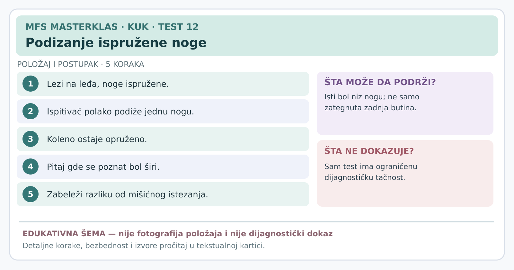

# Kartica 12 — Podizanje ispružene noge — procena nervnog bola

**Status:** edukativna kartica za stručnu reviziju; nije samostalni dijagnostički postupak. **Datum:** 7. novembar 2026.

**Važno za sve testove:** prethodno uraditi anamnezu, isključiti upozoravajuće znake, objasniti postupak, dobiti pristanak i beležiti *poznat* simptom, a ne bilo kakvu nelagodnost. Ako postoji sumnja na prelom, akutno odvajanje tetive, ozbiljnu infekciju ili hitno neurološko stanje, ne izazivati simptome. Testove izvodi osoba obučena za odgovarajući postupak.

**Svrha:** Da li blagi pokret noge reprodukuje poznat bol koji se širi niz nogu?

## Šta zapravo proverava ovaj test?

Kada se noga podiže sa opruženim kolenom, menjaju se napetost zadnje lože i mehaničko opterećenje određenih nervnih tkiva. **Ne ispitujemo direktno disk između pršljenova**. Osećaj istezanja zadnje strane butine **nije isto** što i poznat bol iz nervnog sistema.

## Izvođenje

1. Osoba leži na leđima, obe noge opuštene i ispružene.
2. Ispitivač pridržava petu i potkolenicu testirane noge, **postepeno podiže nogu** savijajući kuk dok koleno ostaje ispruženo.
3. Pita da li se javio pacijentov poznati bol i **gde se širi**; posebno beleži prisustvo osećaja pečenja, strujanja ili trnjenja, a ne samo mišićnog zatezanja.
4. Po potrebi, i samo uz stručnu obuku, položaj stopala ili kolena može se blago promeniti da se proveri menja li se poznati simptom zbog različitog neuralnog opterećenja. To se zove **strukturna diferencijacija** i ni ona nije samostalna dijagnoza.
5. Staje se pri dovoljnoj provokaciji poznatog simptoma — **nije cilj doći do maksimalne visine noge ili do maksimalnog bola**.

## Tumačenje

- **Nalaz koji podržava neuralnu mehanosenzitivnost:** izazvan je **isti bol koji se širi niz nogu**, a promena mehaničkog opterećenja može da promeni taj simptom.
- **Mišićno istezanje:** samo zatezanje zadnje butine bez poznatog nervnog bola nije isto.
- **Negativan:** traženi simptom nije izazvan u pravilnoj, tolerisanoj izvedbi. **Ne isključuje** iritaciju nervnog korena.
- **Neodređen:** jak bol u kuku ili kolenu sprečava pravilno izvođenje, ili se bol ne može jasno lokalizovati.

## Koliko je pouzdan?

**Novi sistematski pregled sa metaanalizom iz 2026. (24 studije) zaključuje da sam test i njegova ukrštena varijanta imaju malu dijagnostičku tačnost za bol poreklom od nervnog korena donjeg dela kičme.** To ne znači da test nema nikakvu kliničku vrednost, već da ga ne smemo nazivati „dokazom diskus hernije”. Potrebno je kombinovati anamnezu sa pregledom osećaja dodira, snage, refleksa i po potrebi medicinskom dijagnostikom.

## Izvori

[Nee i saradnici — sistematski pregled dijagnostičke tačnosti podizanja ispružene noge (2026)](https://pubmed.ncbi.nlm.nih.gov/42843217/) · [Svetsko udruženje neurohirurga — preporuke o dijagnostici lumbalne diskus hernije (2024)](https://pmc.ncbi.nlm.nih.gov/articles/PMC10911853/) · [Britanske preporuke za hitno upućivanje kod neuroloških simptoma](https://www.nice.org.uk/guidance/ng127/chapter/Recommendations-for-adults-aged-over-16)

---
[← Sve kartice kuka](README.md) · [Atlas bola i diferencijalna procena](../dijagnosticki-vodic/README.md)
