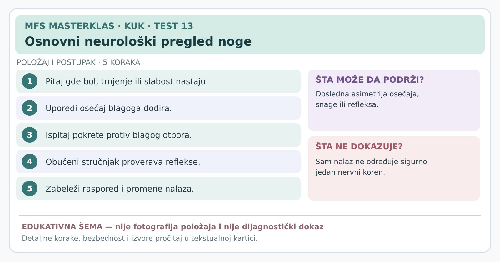

# Kartica 13 — Osnovni neurološki pregled noge

**Status:** edukativna kartica za stručnu reviziju; nije samostalni dijagnostički postupak. **Datum:** 7. novembar 2026.

**Važno za sve testove:** prethodno uraditi anamnezu, isključiti upozoravajuće znake, objasniti postupak, dobiti pristanak i beležiti *poznat* simptom, a ne bilo kakvu nelagodnost. Ako postoji sumnja na prelom, akutno odvajanje tetive, ozbiljnu infekciju ili hitno neurološko stanje, ne izazivati simptome. Testove izvodi osoba obučena za odgovarajući postupak.

**Svrha:** Da li obrazac osećaja, snage i refleksa sugeriše problem nerva?

## Šta znače nervni koren, miotom, dermatom i refleks?

**Nervni koren** je početni deo perifernog nervnog puta koji izlazi iz kičmene moždine kroz odgovarajuće otvore između pršljenova.  
**Miotom** je grupa mišića ili pokreta u kojima određeni koren značajno učestvuje; jedan mišić obično dobija vlakna iz više korenova.  
**Dermatom** je oblast kože kojoj pretežno doprinose vlakna jednog korena; mape se preklapaju i razlikuju među osobama.  
**Tetivni refleks** je automatski odgovor mišića na kratak stimulans tetive; izvode ga i tumače obučeni zdravstveni radnici.

## Izvođenje, korak po korak

1. **Razgovor:** pitati gde su bol, pečenje, trnjenje, utrnulost; da li se šire od krsta preko zadnjice do lista ili stopala; da li ima osećaja zapinjanja stopala ili popuštanja noge.
2. **Osećaj dodira:** osoba zatvori oči; ispitivač lagano dodiruje uporedive delove kože obe noge. Osoba prijavljuje razliku, smanjen osećaj ili neprijatan osećaj. Ovo nije test boli velikom iglom.
3. **Mišićni kapacitet:** obostrano porediti kontrolisano savijanje kuka, opružanje kolena, podizanje stopala, podizanje palca i guranje stopala nadole. Uz svaki pokret beležiti da li je ograničenje povezano sa bolom ili stvarnom slabošću.
4. **Refleksi:** obučeni zdravstveni radnik upoređuje odgovor nakon stimulacije tetive ispod patele i Ahilove tetive; asimetrija i klinički kontekst su važniji od izolovanog „jedan refleks slab”.
5. **Ponovna procena:** uporediti nalaz sa anamnezom i prethodnim pregledom, dokumentovati promenu u snazi ili osećaju kroz vreme.

## Kratka mapa za snalaženje — ne „nerv = samo jedan mišić”

| Nivo korena (objašnjenje) | Pokret koji može pomoći u pregledu | Česta oblast osećajnih tegoba | Tipičan refleks |
|---|---|---|---|
| **Drugi slabinski koren** (oznaka L2) | Savijanje kuka | Gornja i prednja butina | Nema jednog pouzdanog izolovanog rutinskog refleksa |
| **Treći slabinski koren** (oznaka L3) | Opružanje kolena | Prednja butina i područje kolena | Patelarni refleks može biti zahvaćen |
| **Četvrti slabinski koren** (oznaka L4) | Opružanje kolena i podizanje stopala | Unutrašnja strana potkolenice i članka | Patelarni refleks može biti zahvaćen |
| **Peti slabinski koren** (oznaka L5) | Podizanje palca stopala i stopala | Spoljašnja potkolenica i gornji deo stopala | Nema jednostavnog, doslednog standardnog refleksa |
| **Prvi krsni koren** (oznaka S1) | Odgurivanje stopala nadole | Spoljašnja/stopalna strana stopala | Ahilov refleks može biti zahvaćen |

**Ograničenje:** ovi obrasci se značajno preklapaju. Smanjena snaga pri bolnom testu ne dokazuje oštećen nerv, a izolovana mapa utrnulosti ne određuje precizno koren. Treba kombinovati više nalaza.

## Hitno upućivanje — kada ne nastavljamo pregled

**Odmah u hitnu medicinsku procenu** ako bol iz donjeg dela leđa uz simptome noge prati **novonastali poremećaj mokrenja ili stolice, utrnulost u predelu međice, nova seksualna disfunkcija ili ozbiljna, brzo napredujuća slabost**. To su mogući znaci ozbiljnog oštećenja nervnih struktura u donjem delu kičmenog kanala. Ne čekati da provokacioni test bude „pozitivan”.

## Izvori

[Nee i saradnici — sistematski pregled dijagnostičke tačnosti podizanja ispružene noge (2026)](https://pubmed.ncbi.nlm.nih.gov/42843217/) · [Svetsko udruženje neurohirurga — preporuke o dijagnostici lumbalne diskus hernije (2024)](https://pmc.ncbi.nlm.nih.gov/articles/PMC10911853/) · [Britanske preporuke za hitno upućivanje kod neuroloških simptoma](https://www.nice.org.uk/guidance/ng127/chapter/Recommendations-for-adults-aged-over-16) · [Klinička mapa nervnih korenova iz pregleda (2000)](https://pmc.ncbi.nlm.nih.gov/articles/PMC1495170/)

---
[← Sve kartice kuka](README.md) · [Atlas bola i diferencijalna procena](../dijagnosticki-vodic/README.md)
