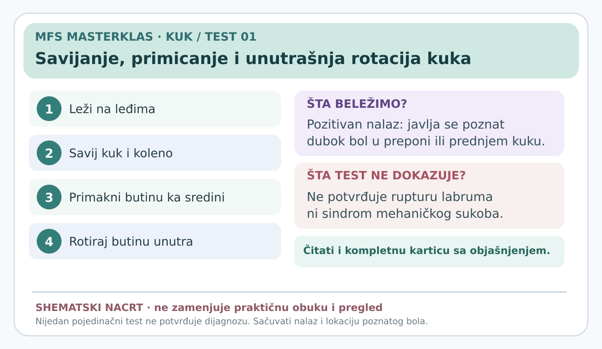
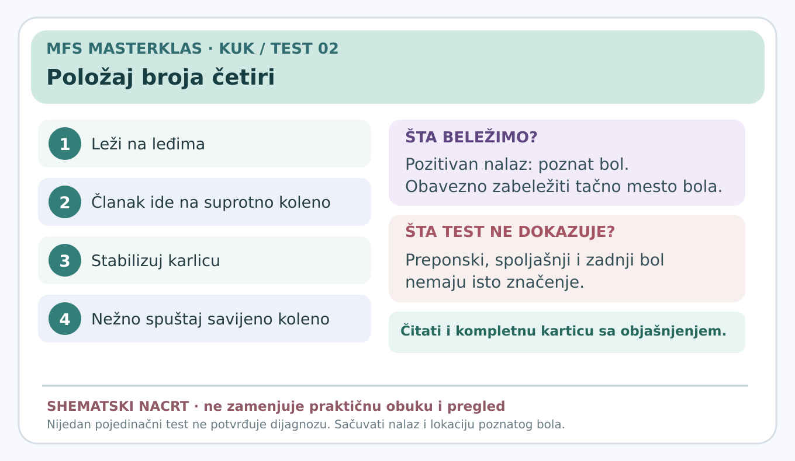
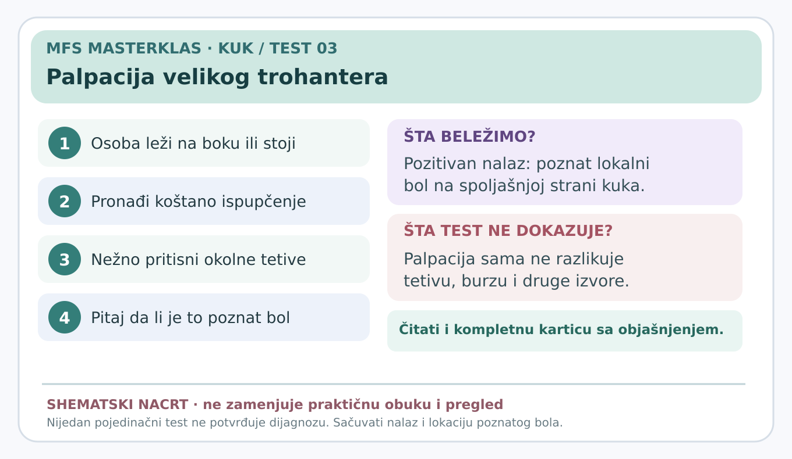
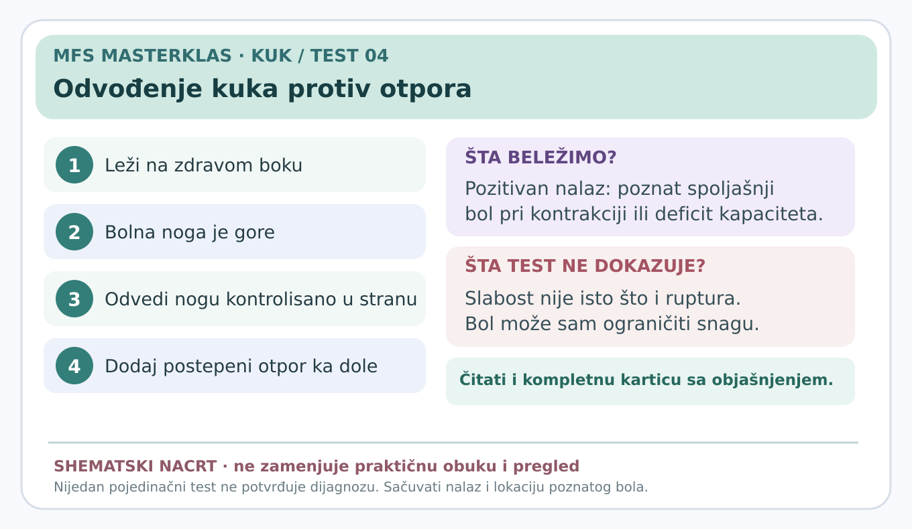

# Kuk — vizuelne kartice testova, serije 01–07

**Datum:** 7. novembar 2026.  
**Status:** serije za stručnu reviziju; informativni vizuelni prikazi i potpun tekstualni protokol, **bez automatske dijagnoze**.

Zahtev Masterklasa: **ne koristiti neobjašnjene skraćenice**. Svaka kartica mora odgovoriti na pitanje zašto se test radi, kako se osoba postavlja, gde stoje ruke ispitivača, kojim redom se pomera noga, šta znači pozitivan, negativan i neodređen nalaz i koje su granice zaključivanja.

## Prva četiri testa

1. [Savijanje, primicanje i unutrašnja rotacija kuka](01-savijanje-primicanje-unutrasnja-rotacija.md) — Provokacija poznatog dubokog bola u preponi.
2. [Položaj broja četiri](02-polozaj-broja-cetiri.md) — Savijanje, odvođenje i spoljašnja rotacija.
3. [Palpacija velikog trohantera](03-palpacija-velikog-trohantera.md) — Provokacija prepoznatljivog spoljašnjeg bola.
4. [Odvođenje kuka protiv otpora](04-odvodjenje-kuka-protiv-otpora.md) — Provokacija lateralnog bola pri radu abduktora.

## Druga serija — kartice 05–07

5. [Aduktori: palpacija i primicanje nogu protiv otpora](05-aduktori-palpacija-i-primicanje-protiv-otpora.md) — razlikovati dva nalaza, palpatornu osetljivost i bol pri primicanju.
6. [Jednonožni oslonac do trideset sekundi](06-jednonozni-oslonac-trideset-sekundi.md) — test bola na spoljašnjoj strani kuka, odvojen od kontrole karlice.
7. [Savijanje kuka protiv otpora](07-savijanje-kuka-protiv-otpora.md) — procena prednjeg bola i kapaciteta pregibača kuka.

## Vizuelni prikazi

**Važno:** SVG slike u GitHub-u su shematske kartice postupka, a ne fotografski dokaz anatomskog položaja. Odvojeni ilustrativni nacrti u PNG formatu napravljeni su za pregled i odobravanje, ali nisu postavljeni u javni repozitorijum jer njihov položaj i strelice zahtevaju dodatnu stručnu vizuelnu proveru. Tekstualna uputstva su merodavna za ovu fazu. Sledeća verzija treba da ima proverene fotografske ili anatomske prikaze ruku, stabilizacije karlice i smera sila.

## Bezbednost

Ne izvoditi provokacione manevre kod sumnje na prelom ili stres-povredu vrata femura, infekciju zgloba, ozbiljnu neurološku bolest ili drugo urgentno stanje. Ne forsirati pokret do jakog bola. Za kliničku primenu potrebni su kompetencija i po potrebi medicinski pregled.

## Izvori

1. [Kliničke smernice za neartrotični bol u kuku (2023)](https://doi.org/10.2519/jospt.2023.0302)
2. [Fizički pregled kuka (2021)](https://pmc.ncbi.nlm.nih.gov/articles/PMC8167346/)
3. [Sistematski pregled testova za spoljašnji bol kuka (2024)](https://pubmed.ncbi.nlm.nih.gov/37561820/)
4. [Evropski stručni konsenzus za bol kuka i prepona (2026)](https://pmc.ncbi.nlm.nih.gov/articles/PMC13622907/)

**Šta dalje:** stručna kontrola vizuelnih položaja, dodatak testa aduktora i oslonca na jednu nogu, pa veza sa konkretnim stanjima iz [našeg dijagnostičkog vodiča](../dijagnosticki-vodic/README.md).

## Novi vizuelni sažeci druge serije

**Ilustrativna fotografska serija:** zaseban PNG triptih postoji kao radni nacrt za stručnu kontrolu položaja, teksta i strelica; u GitHub-u su tekstualne kartice i proverljive shematske kartice.
